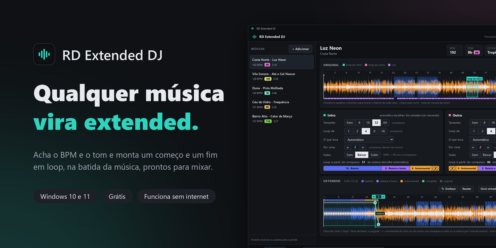
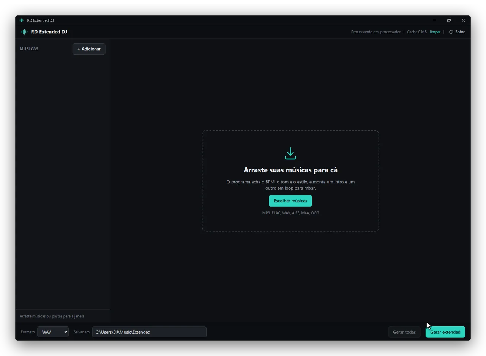
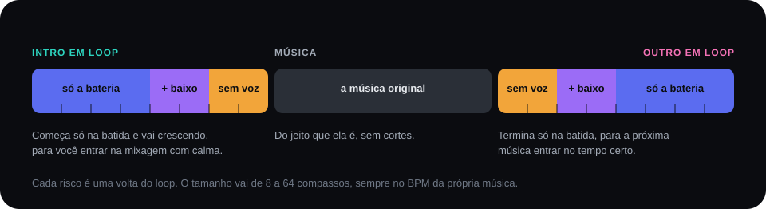
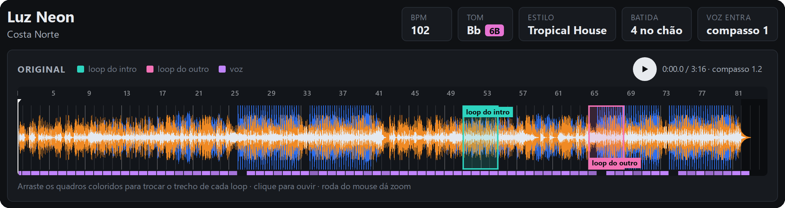
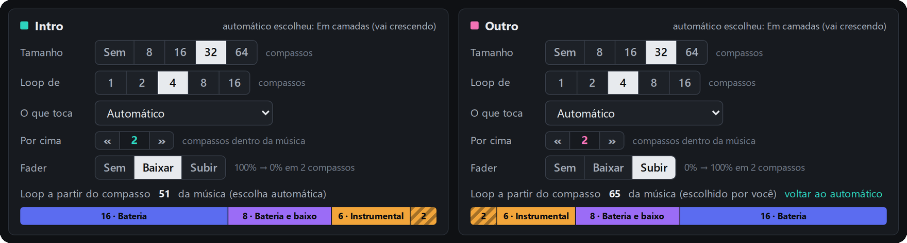
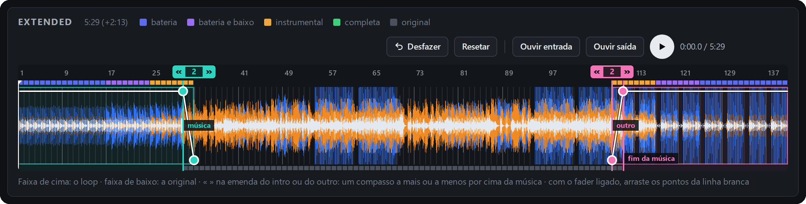

  

  <a href="https://github.com/rmgladius/rd-extended-dj/releases/latest/download/RD-Extended-DJ-Windows.zip"><b>Baixar para Windows</b></a>
  &nbsp;·&nbsp; Windows 10 e 11, 64 bits &nbsp;·&nbsp; grátis e sem instalação

RD Extended DJ é um programa para DJs que transforma qualquer música numa versão extended. Ele descobre
o BPM e o tom, escolhe o melhor trecho para repetir e monta um começo e um fim em loop, do tamanho que
você quiser. É só arrastar as músicas para a janela.

  

## Para que serve

Muita música chega na versão de rádio: a voz começa no primeiro segundo e o fim é seco. Assim não
sobra tempo para encaixar a próxima. O extended resolve isso com um começo e um fim só de batida, na
mesma velocidade da música.

  

## Lê a música para você

  

Ao abrir uma música, o programa mostra o BPM, o tom, o estilo, o tipo de batida e o compasso em que a
voz entra. O tom também sai no código Camelot, que diz quais músicas combinam entre si. Na onda, os
quadros coloridos marcam os trechos que viram loop.

## Intro e outro do seu jeito

  

- **Tamanho:** 8, 16, 32 ou 64 compassos. Também dá para fazer só o intro ou só o outro.
- **O que toca:** em camadas (começa na bateria e vai crescendo), só a bateria, bateria e baixo, sem a
  voz ou a música inteira. No automático, o programa escolhe.
- **Trecho:** se não gostar do loop escolhido, arraste o quadro colorido para outra parte da música.

## Mixagem pronta no arquivo

  

O intro pode continuar tocando por cima do começo da música, e o outro pode entrar antes de ela acabar,
como numa mixagem ao vivo. O fader abaixa ou sobe o loop aos poucos, e as batidas dos dois ficam
alinhadas.

## Ouça antes de gravar

**Ouvir entrada** e **Ouvir saída** tocam direto as emendas. Gostou? **Gerar extended** grava o arquivo
em WAV, AIFF, FLAC ou MP3 320, com o nome e o artista da música original e "(Extended)" no fim. **Gerar
todas** faz a lista inteira, cada música com os próprios ajustes. A música original não muda.

## Como baixar e abrir

1. Clique em [**Baixar para Windows**](https://github.com/rmgladius/rd-extended-dj/releases/latest/download/RD-Extended-DJ-Windows.zip).
   Vem um arquivo .zip de uns 570 MB.
2. Clique nele com o botão direito e escolha **Extrair tudo**.
3. Abra a pasta **RD Extended DJ** e dê dois cliques em **RD Extended DJ.exe**.

Não precisa instalar nada e, depois de baixado, funciona sem internet.

- **"O Windows protegeu o computador":** o aviso aparece porque o programa é novo e não tem assinatura
  paga. Clique em **Mais informações** e depois em **Executar assim mesmo**.
- **Primeira vez de cada música:** leva um minuto e meio ou mais, conforme o computador, porque o
  programa separa bateria, baixo e voz. Depois fica guardado e a música abre na hora.
- **Espaço:** o programa ocupa 1,3 GB, e cada música aberta guarda uns 140 MB. O **limpar**, no topo
  da janela, apaga o que não estiver em uso.
- **Janela em branco no Windows 10:** instale o
  [WebView2 da Microsoft](https://developer.microsoft.com/microsoft-edge/webview2/), que o Windows 11
  já traz.
- **Versão nova:** baixe pelo mesmo botão e troque a pasta antiga pela nova.

Todas as versões ficam em [Releases](https://github.com/rmgladius/rd-extended-dj/releases).

## Para quem programa

Feito em Python. A separação dos instrumentos é do [Demucs](https://github.com/adefossez/demucs), as
batidas do [beat_this](https://github.com/CPJKU/beat_this) e o estilo do
[Discogs-EffNet](https://essentia.upf.edu/models.html). A janela é uma página HTML aberta pelo
[pywebview](https://pywebview.flowrl.com). Como rodar o código, a linha de comando, os detalhes de cada
parte e como gerar o .exe: [docs/COMO-FUNCIONA.md](docs/COMO-FUNCIONA.md).

---

Feito por [Rodrigo Dias](https://github.com/rmgladius). Gratuito e sem fins comerciais.
